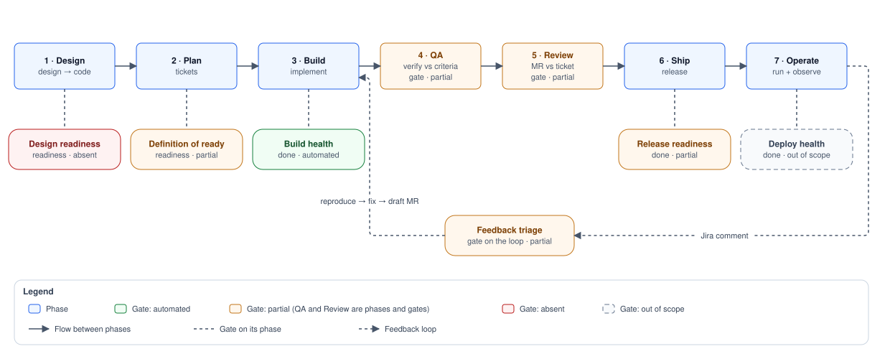
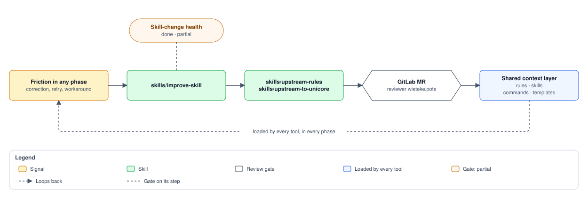

# Pipeline Map

Where every rule, skill, and command in this repo fires in the delivery process.

This repo already has two inventories **by type** — `docs/workflow-canonical-sources.md`
(which surface is canonical per workflow) and `FEATURES.md` (what exists). This
document is the inventory **by process**: for each phase of the delivery pipeline,
which surfaces run, which quality gate closes the phase, and whether that gate is
actually automated or only written down.

Read it to answer three questions:

1. I am at point X in the process — what should I invoke?
2. Which gates does a change pass before it reaches production?
3. Where does the pipeline still rely entirely on a human remembering?

It is written against the seven-phase AI-augmented pipeline spec, and
[Coverage against the pipeline spec](#coverage-against-the-pipeline-spec) states per
proposed automation whether this repo has it, partly has it, or does not.

## The pipeline

QA and Review are drawn as phases because they are also gates in their own right —
everything reaching Ship has passed both, and an AI-authored change passes the same
two, never a lighter parallel path. The other gates hang off the phase they guard:
a **readiness** gate guards a phase's entrance, a **done** gate guards its exit.

## Quality gates

Gates come in two kinds. A **readiness** gate guards the *entrance* to a phase — do
not start work on bad input. A **done** gate guards the *exit* — do not let bad
output advance. Two principles follow from that:

- **Cheapest first.** Build health runs in seconds, QA in minutes, Review costs human
  attention. A change that does not compile should never reach a reviewer, and each
  gate only runs on input that cleared the cheaper one before it.
- **Readiness gates block entry, they do not warn.** The cheapest quality win in the
  whole pipeline is refusing to start work on a vague ticket or an unresolved design.
  Catching that at the entrance costs a comment; catching it at Review costs a rebuild.

Four status markers are used throughout this document, and the fourth is the one that
keeps it honest:

| Marker | Means |
| --- | --- |
| ✅ | automated — it runs whether or not anyone remembered |
| ⚠️ | partial — encoded somewhere, but a human still arms or interprets it |
| ❌ | absent and wanted — a real gap, filed or recorded below |
| ⛔ | out of scope — decided against for this stack, with the reason stated |

⛔ is not a softer ❌. An absent gate is debt; an out-of-scope one is a closed
decision, recorded so it stops being re-proposed at every review. Both are listed —
[Deliberately out of scope](#deliberately-out-of-scope) holds the closed ones.

| Gate | Kind | Guards | Enforced by | Status |
| --- | --- | --- | --- | --- |
| Design readiness | readiness | entry to Plan — design resolved, tokens and states settled, a11y decided | nothing | ❌ absent |
| Definition of ready | readiness | entry to Build — testable acceptance criteria, clear definition of done, no ambiguity, **and a scope that fits one reviewable MR** | `rules/backlog.md` (the list) + `rules/mr-sizing.md` + the ready check in `skills/backlog` | ⚠️ partial — the check proposes and the developer flips `ready`, but nothing runs it from planning yet |
| Build health | done | exit from Build — compiles, types, lint, unit tests, no committed secrets | `skills/run-checks`, plus `skills/migration-check` when the diff touches migrations | ✅ automated; derived from the CI job list on CI v4 (`ci-components`), ⚠️ approximate on `config/ci` |
| QA | done | the build against the ticket's acceptance criteria, per criterion | `skills/run-checks`, `skills/code-review`, `skills/architecture-review`, `skills/wcag-audit`, `skills/sustainable-review`, the project `verify` skill that `scripts/sync.sh` emits (checks and screenshots before a commit), plus the BLI's `How to verify` steps that `skills/work-backlog` fills from what it actually ran | ⚠️ partial — the steps are recorded per item, but the pass is a claim in prose: no artefact a reviewer can re-run to confirm it |
| Review | done | the MR against the ticket | `skills/code-review`, `skills/receiving-code-review` | ⚠️ partial — no ticket-drift check (doc freshness covered via `rules/documentation.md`) |
| Release readiness | done | safe to ship — dependency and licence scanning, API-contract/breaking-change detection, docs updated | `skills/watch-mrs` (approval, pipeline, conflicts via `detailed_merge_status`), `skills/npm-maintenance` (dependencies, out of band) | ⚠️ partial — merge-readiness only, armed by hand |
| Deploy health | done | the release is healthy in production — a post-deploy smoke check | nothing | ⛔ out of scope — canary and rollback automation are for traffic these projects do not have; a smoke check in CI is the whole intended ceiling |
| Feedback triage | gate on the loop | is this comment actionable at all, before anything is reproduced or fixed | nothing | ❌ absent — filed, deliberately not next |
| Skill-change health | done | exit from Improve — a skill that was edited still does what it did, and its new routing actually triggers | `claude plugin eval` over selected cases in `evals/`; the MR flow (`skills/create-pr`, the upstream MR rule) selects only cases for the changed behavior, one run per case with a cost ceiling, following `evals/README.md`; broader suites and extra runs require explicit approval of scope and total budget | ⚠️ partial — targeted runs are model guidance, not a mechanical gate; coverage and fixtures remain incomplete, and no CI job runs paid evals |
| Workflow-asset review | done | any change to **this** repo | feature branch → GitLab MR → reviewer `wieteke.pots` (`shared/workflow-assets.md`) | ✅ policy, human-enforced |

## The improve loop

The seven-phase picture describes how work flows through a *product* repo. It does
not show how work re-enters *this* repo — which is the whole reason ai-workflows
exists. That is the eighth lane:

The dotted gate is only half there. A skill edit closes on a human reading
the diff plus the targeted eval cases selected for its changed behavior
(`evals/README.md`, "Before a skill MR"). `skills/improve-skill` may rewrite
the instructions that drive every other phase. Some cases need a fixture,
routing coverage is incomplete, and no CI job runs paid evals. Broader suites
and additional runs require explicit approval of scope and total budget.
See [Gaps](#gaps).

Every change to this repo passes that gate — a developer editing a rule by hand and
an agent running an upstream skill are treated identically. No direct pushes to
`main`, and the GitHub mirror is not a substitute.

## How a surface is invoked

The phase tables below carry an **Invoked by** column. Six modes exist, and they differ
in one thing that matters: who decides to run it.

| Mode | Notation | Who triggers it |
| --- | --- | --- |
| Direct | `/name` | The developer, by name |
| Intent match | `"phrase"` | The tool, by matching the skill's `description` — this is why the validator warns on a description without a `Use when …` routing cue |
| Trigger phrase | `"phrase" → command` | The tool, from `shared/command-mappings.md` (commands) or `shared/skill-mappings.md` (skills), inlined into every generated adapter — the fallback path for tools that cannot use skills |
| Delegation | `via skills/x` | Another skill, as a step in its own flow. No human decision at all |
| Hook | `hook: Event(Matcher)` | The harness, on a tool event. Fires whether or not anyone remembered |
| Loop | `loop` | Started once, then keeps running on its own until stopped |
| Rules | `loaded` | Nothing invokes a rule — it is read into context, ambient or on demand |

`shared/command-mappings.md` covers every command runbook and
`shared/skill-mappings.md` every skill; `scripts/validate-skills.mjs` errors when
either falls behind, so a runbook like `commands/refinement.md` can no longer sit
in the repo without a trigger phrase. The counts are deliberately not written out
here — the validator is the guarantee, and a number in prose only goes stale. Both fragments are injected into
`AGENTS.md`, which is where a tool actually reads them. `CLAUDE.md`, which every
Claude session loads, takes the skill fragment plus only the command rows no
skill row covers (the validator holds the two in step); on Claude the skill
descriptions route in parallel via the plugin.

### Hooks and loops

Automation that runs without being asked is thin but real, and it is not evenly
distributed. Four plugin-wide hard gates and a retrospective prompt ship through
`hooks/hooks.json`; four project harness hooks ship through
`templates/project-claude-settings.json`:

| Hook | Event | Does |
| --- | --- | --- |
| Process-termination approval | `PreToolUse(Bash)` | **Always asks** before `kill`, `pkill`, `killall`, or `taskkill`, even when a local allowlist would otherwise permit the command; the shared safety rule separately forbids terminating VS Code without approval for the exact PID and command |
| CLI-first connector gate | `PreToolUse(mcp__.*)` | **Denies** an Atlassian or Axiom connector call that has a CLI equivalent while that CLI is installed, naming the `jira`/`axiom` command to run instead (`scripts/prefer_service_cli.py`); connector-only tools, other servers, a missing CLI and `AIW_ALLOW_MCP=1` pass through |
| Pinned install runtime | `PreToolUse(Bash)` | **Denies** an `npm`/`pnpm` install (`install`, `ci`, `update`, `audit fix`, …) whose Node or npm differs from the project's pin (`.nvmrc`, `.node-version`, Volta, `engines`, `devEngines`, `packageManager`; without an npm pin, the npm bundled with the pinned Node), npm in a pnpm project or the reverse, and flags that switch the engine check off (`--force`, `--engine-strict=false`). An install through `fnm exec` is judged on the Node fnm selects. The deny names the command on the pinned runtime, `fnm exec --using=…` when fnm has it and the nvm install otherwise, or asks for `fnm install <pin>` / `nvm install <pin>` when it is missing; global installs, pnpm's own version and unpinned projects pass (`scripts/require_pinned_install_runtime.py`) |
| Ticket-transition approval | `PreToolUse(Bash\|mcp__.*__transitionJiraIssue)` | **Always asks** before `jira issue move` (aliases `transition`, `mv`) or a connector `transitionJiraIssue`, even when `Bash(jira *)` is allowed: Jira's automation moves tickets from the pipeline, so a status change needs the user's go; a headless run is denied (`scripts/require_ticket_transition_approval.py`) |
| Improve-skill retrospective prompt | `Stop` | **Asks once per session**, by blocking the stop once, whether to run `skills/improve-skill` — only after a Greenberry skill ran and the user then stepped in: an interrupt, an explicit tool rejection, or typing right after a failed tool call that was the run's latest outcome. Never runs it or edits a skill itself (`scripts/improve_skill_retrospective.py`) |
| Migration guard | `PreToolUse(Bash)` | **Denies** every migrate script (`migrate`, `migrate:status`, `migrate:create`, `migrate:fresh`, `migrate:reset`, `payload migrate*`) — the only mechanically blocking gate in the whole pipeline |
| Graphify-before-grep | `PreToolUse(Bash)` | Requires a graph query before raw grep/find, when `graphify-out/graph.json` exists |
| Graphify-before-read | `PreToolUse(Read\|Glob)` | Same, for reading source files |
| Graph refresh | `PostToolUse(Edit\|Write)` | Rebuilds the knowledge graph in the background after an edit |

One loop: `skills/watch-mrs` runs as a `Monitor` task with a `ScheduleWakeup`
heartbeat. It is **session-scoped** — no durable cross-session schedule exists for
GitLab, so nothing survives closing the laptop.

Two asymmetries worth naming. This repo ships harness hooks to projects but configures
none for itself; its only own automation is the git pre-commit hook from
`scripts/install-hooks.sh`, which runs the validators. And the hooks that exist are
mostly *nudges* — only the migration guard and the CLI-first connector gate
actually block. The Stop prompt above closes the improve-skill gap by blocking once to
ask, never to run.

## Phase by phase

### Design — design → code

Turning a design or a requirement into something implementable.

| Surface | Type | Invoked by | Role |
| --- | --- | --- | --- |
| `skills/start-project` | skill | `/start-project` · `"project kickoff"`, `"nieuw project"`, `"init project"`, `"project brief"` | The single kickoff entry, six lanes plus a first run, in order: **repository** (created via the GitLab template flow into the client group; deviations reported, PoC waiver recorded in the brief + decision log, template MRs since the base listed for porting), **config** (`skills/setup-ai-workflows`), **first run** (the developer's day-one path run for real; failures routed to a template fix or a backlog item), **resources** (design/CMS/hosting/tracker/credential owners, collected before anything is written), **intent** (docs/project-brief.md, docs/project-spec.md, docs/architecture.md), **journeys** (`skills/user-journeys`), **plan** (`skills/backlog` + `skills/jira-ticket`, sized per `rules/mr-sizing.md`) |
| `templates/project-brief.md`, `templates/project-spec.md`, `templates/project-architecture.md` | templates | read by `skills/start-project` | The content contract for those three documents |
| `skills/user-journeys` | skill | `/user-journeys` · `"user journeys"`, `"user flows"`, `"journeys uitwerken"` · delegated by `skills/start-project` | One document per journey in docs/journeys/ (per project): walked path, decision points, alternate and error paths, per-surface states, permissions, keyboard route, measurement — plus the **slice candidates** the backlog is cut from. Reads the spec and the Figma frames; harvests routes and roles on a retrofit |
| `templates/user-journey.md` | template | read by `skills/user-journeys` | The content contract for a journey document |
| `skills/component-spec` | skill | `/component-spec` · `"component spec"`, `"document component api"` | Production-ready component spec: API, a11y requirements, keyboard + screen-reader behaviour, testing guidance, open questions |
| `rules/tailwind.md` | rule | loaded — styling and token tasks | Design tokens via `@theme`; how a design system maps onto utilities |
| `rules/accessibility.md` | rule | loaded — interactive UI and a11y tasks | Semantics, contrast, keyboard behaviour — decided here, not patched in QA |
| Figma MCP | connector | MCP tool call, mid-task | `get_design_context`, `get_variable_defs`, `get_screenshot` — provided by the Figma connector (claude.ai), not by a repo-defined MCP server |

**Gate — Design readiness: absent.** Nothing checks that design tokens, states, and
a11y behaviour are settled before a ticket is written. `skills/start-project` gives
that gate something concrete to check against — a release spec with rules,
non-functionals and recorded open decisions — and `skills/user-journeys` narrows it
per step: a journey document names the steps whose design is missing, whose keyboard
route is unclear, or whose state is undecided. Writing that list is still not the
same as blocking on it. See [Gaps](#gaps).

What is *wanted* here is that blocking check on the journey and spec output. The
frame-level automations the spec also proposes for this phase — auditing a11y on Figma
frames, diffing tokens against the Figma source, checking whether a component already
exists — are ⛔ out of scope: low frequency, and the Figma connector already sits in the
loop during Build, where the same questions get answered against real code instead of
against a frame. Recorded in
[Deliberately out of scope](#deliberately-out-of-scope) so the empty Design column
reads as a decision rather than as neglect.

### Plan — tickets

Turning intent into work items with acceptance criteria.

| Surface | Type | Invoked by | Role |
| --- | --- | --- | --- |
| `skills/refinement` | skill | `/refinement` · `"refine tickets"`, `"prepare refinement"` | Prep and record refinement: grouping, story points, conflicts, per-ticket questions — tracker read-only |
| `skills/sprint-planning` | skill | `/sprint-planning` · `"plan sprint"`, `"start sprint"` | Sprint scope, spillover carry-in, dependency mapping, realism against velocity; creates the `docs/sprint-<N>/` folder a BLI moves into when it is set `done` |
| `skills/backlog` | skill | `/backlog` · `"backlog item"`, `"user story"`, `"bli"`, `"is this item ready"` | Draft or update a local backlog item in `docs/backlog/`, and run the ready check: each item against the Definition of Ready, a next step per open point, `ready` only after the developer confirms |
| `skills/jira-ticket` | skill | `/jira-ticket` · `"maak een jira ticket"`, `"file a story"` | Create a Jira bug/story/task from a type-specific template — the one sanctioned tracker **write** |
| `commands/refinement.md`, `commands/sprint-planning.md`, `commands/backlog.md` | commands | trigger phrase → command; `refinement.md` has **no** mapping | Fallback runbooks for tools that cannot use skills |
| `rules/backlog.md` | rule | loaded — user story, spec, backlog work | User story, spec, and backlog-item structure |
| `rules/adr.md` | rule | loaded — recording an architecture decision, creating a project's ADR folder or architecture doc, or changing something a recorded decision covers | Architecture Decision Records: when to write one, the `adr/` layout under the project's docs folder, statuses, MADR-lite template; append-only, supersede instead of edit |
| `rules/mr-sizing.md` | rule | loaded — whenever work is sized or sliced, and at MR time | One ticket to many items: size budget, sliceability test, split triggers. Blocking at planning, advisory at the MR |
| `docs/backlog/` | context | read by `skills/work-backlog` at pickup | Local BLIs — the definition of done that `skills/work-backlog` consumes |

**Gate — Definition of ready: partial.** `rules/backlog.md` holds the Definition
of Ready, and `rules/mr-sizing.md` adds the size half of it — an item too big for
one reviewable MR is not ready, however clear its criteria are. The ready check in
`skills/backlog` holds items against that list, routes every open point to a next
step, and proposes; the developer flips `ready`, and only then may
`skills/work-backlog` build the item unattended. Still nothing runs the check from
planning: sprint-planning overwrites the status with `Planned for Sprint <N>.`, and
work-backlog reports a draft item without its route
(`docs/backlog/feat-delivery-guidance-2-ready-check-in-the-path.md`).

### Build — implement

| Surface | Type | Invoked by | Role |
| --- | --- | --- | --- |
| `skills/work-backlog` | skill | `/work-backlog` · `"work the backlog"`, `"next backlog item"` | Autonomous delivery of one BLI, WIP limit 1 — spans Plan → Review and calls the phases below. Before the MR it fills the BLI's `How to verify` from what it actually ran, and names the slice when the ticket has several |
| `skills/test-driven-development` | skill | `/test-driven-development` · `"tdd"`, `"test eerst"` · delegated by `skills/work-backlog` | Strict RED-GREEN-REFACTOR for a feature or bugfix |
| `skills/scaffold-component` | skill | `/scaffold-component` · `"new component"`, `"scaffold"` | New component with the project's file structure and conventions |
| `skills/commit-message` | skill | `/commit-message` · `"commit message"`, `"git commit"` | Conventional commit message from the diff |
| `commands/work-backlog.md`, `commands/scaffold-component.md`, `commands/commit-message.md`, `commands/safe-kill-port.md` | commands | trigger phrase → command (`"kill port"`, `"eaddrinuse"`) | Fallback runbooks; `safe-kill-port` is local-dev hygiene |
| Migration guard | hook | **hook** `PreToolUse(Bash)` — denies every migrate script (`migrate`, `migrate:*`, `payload migrate*`) | The one gate in the pipeline that mechanically blocks instead of warning |
| Graphify guards | hooks | **hooks** `PreToolUse(Bash)` and `PreToolUse(Read\|Glob)` | Query the knowledge graph before grepping or reading source, when a graph exists |
| Graph refresh | hook | **hook** `PostToolUse(Edit\|Write)` | Rebuilds `graphify-out/` in the background after an edit |
| `rules/project.md` | rule | loaded — ambient for code work | Structure, naming, component architecture, function style |
| `rules/type-safety.md` | rule | loaded — TS-heavy code, API/JSON/env/DB boundaries | Trust boundaries, strict TS posture, lint guardrails |
| `rules/clean-architecture.md` | rule | loaded — ambient for code work | Layer boundaries and dependency direction |
| `rules/content-blocks.md`, `rules/payload.md` | rules | loaded — CMS blocks; Payload schemas, hooks, jobs | CMS-backed block architecture; Payload schemas, generated types, hooks, jobs queue |
| `rules/testing.md` | rule | loaded — tests and test reviews | Testing strategy and query priority while writing code |
| `rules/sustainability.md` | rule | loaded — perf, bundle, asset work | Runtime, bundle, and asset cost as a build-time concern |
| `rules/stacks/nextjs-payload.md`, `rules/stacks/react-native-expo.md` | rules | loaded — after checking `package.json` | Stack-specific conventions layered on the baseline |

**Gate — Build health: automated** via `skills/run-checks`.

### QA — verify vs criteria

Verifying the change against its acceptance criteria and the project's standards,
before another human is asked to look at it.

| Surface | Type | Invoked by | Role |
| --- | --- | --- | --- |
| `skills/run-checks` | skill | `/run-checks` · `"run checks"`, `"quality checks"` · delegated by `skills/work-backlog` and `skills/create-pr` | On CI v4, exactly the scripts of the `verify` job (read from `.gitlab-ci.yml` by `skills/run-checks/scripts/ci-parity.mjs`); otherwise lint, type-check, stylelint, test, build. In sequence, stops on failure for a decision, reports the CI parity |
| `.claude/skills/verify/SKILL.md` (from `templates/project-verify-SKILL.md`) | project skill | Claude Code runs it before each commit except docs-only and tests-only ones — model guidance, not a hard gate · emitted once per project by `scripts/sync.sh --project`, project-owned afterwards | Follows `skills/run-checks`, then for a UI diff opens the affected routes in a browser and reports observations and the screenshot paths the browser tool printed (Playwright MCP: the `.playwright-mcp/` folder sync gitignores); says "unverified" when the session has no browser control |
| `skills/code-review` | skill | `/code-review` · `"review changes"`, `"code review"` | Severity-ordered self-review of the branch diff with explicit type-safety audit |
| `skills/architecture-review` | skill | `/architecture-review` · `"check clean arch"`, `"audit layer violations"` | Clean-architecture violations against the project's *actual* folder mapping |
| `skills/migration-check` | skill | delegated by `skills/create-pr` when the diff touches `migrations/` · `/migration-check` | Static check of a generated Payload/Postgres migration for snapshot drift — read-only, never runs `migrate` |
| `skills/datocms-migration` | skill | `/datocms-migration` · `"datocms migration"`, `"change the cms schema"` | Sandbox-fork → autogenerate → review loop for a DatoCMS schema change; catches destructive, out-of-scope, and instance-specific-ID operations before they ship |
| `skills/wcag-audit` | skill | `/wcag-audit` · `"a11y audit"`, `"wcag compliance audit"` | Static WCAG review against `rules/accessibility.md` (the automated production scan sits in Operate) |
| `skills/sustainable-review` | skill | `/sustainable-review` · `"performance audit"`, `"green refactor"`, `"ci review"` | Runtime, bundle, asset, dependency and CI cost of the change |
| `commands/run-checks.md`, `commands/review-code.md`, `commands/sustainable-review.md` | commands | trigger phrase → command | Fallback runbooks |
| `rules/sonarqube.md` | rule | loaded — static-analysis and quality-gate work | Quality-gate expectations for static analysis |

**Gate — Build health: automated.** Note the sustainability constraint: the full
sweep runs **once**, immediately before pushing — QA scopes checks narrowly while
building instead of re-running everything.

### Review — MR vs ticket

| Surface | Type | Invoked by | Role |
| --- | --- | --- | --- |
| `skills/create-pr` | skill | `/create-pr` · `"open pr"`, `"submit pr"` · delegated at the end of `skills/work-backlog` | Rebase onto base, push, open PR/MR with a description generated from the diff; pre-flight delegates to `skills/migration-check` and `skills/code-review`; a UI diff is served from the branch and opened in a browser the user sees before the approval ask, and screenshots go into the description only after a yes |
| `commands/create-pr.md` | command | `"create pr"` → command | Fallback runbook |
| `skills/code-review` | skill | `/code-review` · also accepts an MR/PR **URL** | Review a branch, MR, or PR by URL; can post inline MR comments after a go-ahead |
| `skills/receiving-code-review` | skill | `/receiving-code-review` · `"reviewer comments"`, `"reageer op review"` | Evaluate incoming feedback with rigour — verify, push back where wrong, then apply |
| `skills/address-review-comments` | skill | `/address-review-comments` · `"pick up review feedback"` · handed off from `skills/receiving-code-review` | Apply approved feedback, run checks, push, rebase, hand back to the reviewer, clean up |
| `skills/watch-mrs` | skill | `/watch-mrs` · `"watch my MR"`, `"notify me on approval"` → then runs as a **loop** (`Monitor` + heartbeat), session-scoped | Background loop over new comments, merge-readiness, and pipeline transitions — names the failing job/stage, offers triage, hands merges to `skills/mr-merged`; opt-in auto-merge |
| `rules/documentation.md` | rule | loaded — mandatory before writing or editing any source file, and during review | Comments, JSDoc, and docs describing changed behaviour update in the same MR; one home per durable fact, so a measurement cannot drift across copies; docblocks attach to a declaration |
| `rules/mr-sizing.md` | rule | loaded — when an MR is opened or reviewed | The advisory end of the budget: report the overrun and where the cut belonged; re-slicing merge-ready work is not the answer |
| `rules/git-flow.md` | rule | loaded — branching, opening or merging an MR, checking merge settings | Squash + fast-forward baseline, MR title as the commit message, `ai:agent-authored` as the provenance signal a squash cannot drop; `scripts/gitlab-merge-settings.mjs` checks and (after a go) fixes a project |

**Gate — Release readiness: automated but armed by hand.** `skills/watch-mrs` can
watch a MR the moment it exists, but nothing arms it — which is why a red pipeline
can sit unnoticed. See [Gaps](#gaps).

### Ship — release

| Surface | Type | Invoked by | Role |
| --- | --- | --- | --- |
| `skills/watch-mrs` | skill | **loop**, already running — acts on its own once armed with auto-merge | Merges once the MR is mergeable, when auto-merge was explicitly enabled for that invocation; offers the `skills/mr-merged` closeout after any merge |
| `skills/close-sprint` | skill | `/close-sprint` · `"sluit sprint af"`, `"wrap up sprint"`, `"close support month"` | Sprint changelog (compact template), gaps/spillover, delivered BLIs filed in the sprint folder (most already moved there by their `done` commit), the sprint's working documents (planning, refinement, tracker, journal) cleared out — or, on projects without sprints, the `docs/support-<yyyy>-<mm>/` equivalents (support mode) |
| `skills/compact-sprint` | skill | `/compact-sprint` · `"sprint compacten"`, `"compact old sprints"` — after a close, over sprints whose close is pushed (support months older than the previous one) | Flag-only harvest of durable decisions into the project's todo docs, compact changelog rewrite, archive folder and gaps doc removed behind a `sprint-<N>-bli-archive` / `support-<yyyy>-<mm>-bli-archive` tag |
| `skills/sprint-demo` | skill | `/sprint-demo` · `"demo voorbereiden"`, `"demo script"` | Presenter runsheet plus a Marp deck for sprint review |
| `skills/release-notes` | skill | `/release-notes` · `"release notes"`, `"wat is er live"` · named in the wrap-up of `skills/close-sprint` and `skills/sprint-demo` | Notes the customer reads, for a release range or a closed sprint: sources by trust, security phrased as outcome, an ancestor check against the production ref before anything is called live, `docs/releases/<key>.md` plus a paste-ready block — draft only, never posted |
| `skills/release` | skill | `/release` · `"release starten"`, `"naar productie"`, `"release afronden"` · after the acceptance state is accepted, or after the fact for a tag's tickets | The release around the project's own runbook: recipients and Slack asked up front, a start-mail draft with a two-hour indication, the runbook's promotion, tag and back-sync, notes via `skills/release-notes`, a live-mail reply draft with the overview, shipped tickets classified from the range and given a version (label fallback without Jira rights), their status read back and moved only on the user's go per ticket, then the close-sprint check and stale-branch cleanup — mail drafted, never sent. An unversioned project gets a one-time proposal to introduce versions, and the decision lands in `CONVENTIONS.md` |
| `commands/close-sprint.md`, `commands/compact-sprint.md`, `commands/sprint-demo.md`, `commands/release-notes.md` | commands | trigger phrase → command | Fallback runbooks |
| `skills/mr-merged` | skill | `/mr-merged` · `"MR merged"`, `"post-merge"`, `"afgerond na merge"` · hand-off target when `skills/watch-mrs` reports a merge | Post-merge closeout: **ticket-completeness gate** (every item carrying the key `done` on the default branch, derived from `docs/backlog/` and the sprint folders), "How to test this" comment for the PO covering the whole capability (posted after approval, deferred while slices remain), ticket status read back (Jira's automation moves it), branch/worktree cleanup |
| `skills/dependency-hotfix` | skill | `/dependency-hotfix` · `"pak de critical op"`, `"critical hotfix"` — after the weekly dependency-scanner report flags a critical on production | The out-of-band path to production: minimal bump on a hotfix branch off production, MR with GitLab auto-merge, deploy read-back, then production back-merged into acceptance and development (pushes when `squash_option` is `always`, so the ancestry survives), a Slack thread, and cleanup — one go, resumable |

**Gate — Deploy health: out of scope.** `skills/mr-merged` hands the PO a way to test
what shipped, and `skills/release-notes` tells the customer what is live where — after
checking each item against the production ref, not by trusting the sprint changelog.
Nothing verifies the deploy itself, and the intended ceiling is a post-deploy smoke
check in CI — canary rollout, automated rollback, and a semver suggestion per client
release are ⛔ out of scope for agency delivery on managed hosting. See
[Deliberately out of scope](#deliberately-out-of-scope).

### Operate — run + observe

| Surface | Type | Invoked by | Role |
| --- | --- | --- | --- |
| `skills/maintenance` | skill | `/maintenance` · `"onderhoud"`, `"monthly health check"`, `"api key check"` | Periodic sweep across every lane that rots silently: deps, runtime EOL, credential and API-key currency, quality baseline, CI, data, doc drift |
| `skills/greenberry-maintenance` | skill | `/greenberry-maintenance` · `"portfolio maintenance"`, `"greenberry onderhoud"`, `"herhaal onderhoudsinventaris"` | Read-only portfolio evidence across GitLab CI adoption, Notion metrics, existing scan artifacts and dependency-channel reporting; records coverage gaps and deltas without starting scans, syncs or fixes |
| `skills/npm-maintenance` | skill | `/npm-maintenance` · `"audit dependencies"`, `"patch a CVE"` | Dependency updates, `npm audit` remediation, researched major migrations |
| `skills/payload-jobs` | skill | `/payload-jobs` · `"nightly job"`, `"autoRun"`, `"jobs draaien dubbel"` · delegated by lane F of `skills/maintenance` | Payload's jobs queue on multi-instance hosting: one elected runner, closed run endpoint, orphaned-run recovery, idempotent tasks, poll cadence vs the autoscaler |
| `skills/wcag-audit` | skill | `/wcag-audit` · `"a11y audit of production"` | axe-core/Playwright scan of the live site, combined with the static findings |
| `skills/sustainable-review` | skill | `/sustainable-review` · `"sustainability review"` | Production runtime, caching, asset and CI-cost audit |
| `skills/jira-ticket`, `skills/backlog` | skills | `/jira-ticket`, `/backlog` — by hand, after a human reads a report | The landing point of feedback triage: an observation becomes a ticket or a BLI |

`skills/maintenance` is the entry point for this phase: it diagnoses across all
lanes and delegates the deep work to the lane-specific skills above, landing one
ranked report instead of several partial ones.

For Greenberry-wide coverage and CI-adoption questions,
`skills/greenberry-maintenance` is the portfolio entry point. It compares the
current register/configuration with existing execution evidence and the previous
dated inventory. It does not run the per-project sweep or apply its findings;
requested fixes use the existing project workflows.

That makes the sweep one invocation instead of five, but it does not make it
automatic: nothing in this phase runs on a schedule. Every row above is invoked by
hand, which is the honest reason periodic maintenance slips — no cron, no routine,
and, per `skills/watch-mrs`, no durable cross-session scheduling available for
GitLab. That mechanism gap is the one thing this phase actually needs.

The observability half of the phase is a different matter. Incident triage from an
error spike and log or on-call summarisation are ⛔ out of scope: there is no
per-project observability stack to reason over, so a skill for it would have nothing to
read. Revisit if a project ever gets one — not before.

**Feedback triage** is the dotted arrow back into Build, and it is a gate before it is
an automation: classify whether the comment is actionable at all, reproduce it as a
failing test before fixing anything, stop and ask on the ticket when it cannot be
reproduced, and open the fix as a **draft** MR that re-enters the pipeline at QA and
Review like any other change. No surface owns any of that today, and building one
is parked (gap 11 below). The failure mode being designed against is
not a bad fix surviving review; it is an agent confidently "fixing" a misclassified
comment, or a fix that passes its own narrow reproduction test while breaking what the
test never covered. Both are caught by the full QA pass and the human merge gate,
which is exactly why an AI-authored change gets neither skipped.

### Improve — maintaining the pipeline

Rows whose *Invoked by* cell carries the marker `enforced by nothing` (after
an em-dash) are budgeted: `scripts/validate-skills.mjs` counts that marker and
fails when the count exceeds its `ENFORCED_BY_NOTHING_BUDGET`. A new
unenforced policy either ships its enforcement or raises the budget in the
same MR with a tracked follow-up — the label stays honest because the pile
cannot silently grow.

| Surface | Type | Invoked by | Role |
| --- | --- | --- | --- |
| `skills/improve-skill` | skill | `/improve-skill` · `"verbeter je skill"`, `"take learnings"`, `"learn from sessions"` · **policy says** after any run that needed intervention · offered once per session by the `Stop` hook (`scripts/improve_skill_retrospective.py`) | Post-run retrospective: fold friction back into the skill's canonical source, decide whether a recurring pattern deserves a new skill or a lighter surface, and author the new skill when warranted |
| `evals/<skill>/<case>/` | evals | The MR flow selects exact cases for changed behavior before the first push (`evals/README.md`), one run each with a cost ceiling; whole suites and extra runs require explicit scope and budget approval — no CI job | Regression cases for skill output and routing; some are runnable in an empty workspace, others need a fixture |
| `skills/upstream-rules` | skill | `/upstream-rules` · `"propose rule"` · **should** fire whenever a shared asset is edited in a synced project | Propose a rule/skill change back to this repo as a GitLab MR |
| `skills/upstream-to-unicore` | skill | `/upstream-to-unicore` · `"port to unicore"`, `"template harvest"` · **proposed** by `skills/mr-merged` and `skills/close-sprint` when template-owned files changed | Port reusable work into `unicore-template` on the release line chosen per change (v3 or v4), by name or as a harvest against the project's `.unicore.json` base; starts from the open template MR queue and hands the MR to `skills/watch-mrs` |
| `skills/setup-ai-workflows` | skill | `/setup-ai-workflows` · `"apply ai-workflows"`, `"generate conventions"` | Generate `CONVENTIONS.md`, thin tool adapters, and sync shared assets into a project |
| `commands/setup-ai-workflows.md`, `commands/new-device-setup.md` | commands | trigger phrase → command (`"new device"`, `"onboarding"`) | Fallback runbook; new-machine bootstrap |
| `scripts/sync.sh`, `scripts/generate-adapters.sh` | scripts | shell, by hand: `./scripts/sync.sh --project <path>` | Distribute canonical sources to projects and regenerate derived adapters |
| `scripts/validate-ai-instructions.sh`, `scripts/validate-skills.mjs`, `scripts/smoke-test-project-sync.sh` | scripts | **git pre-commit hook** + CI (`.gitlab-ci.yml`) — the repo's only self-enforcing automation | Drift detection: CI and the hook run the same validators |
| `scripts/install-hooks.sh` | script | once per clone, by hand | Installs that pre-commit hook |
| `docs/workflow-canonical-sources.md` | doc | read when adding a surface; completeness checked by the validator | Which surface is canonical per workflow |
| `docs/skills-first-migration-plan.md` | doc | read for context on the surface strategy | Why skills are canonical and commands are the fallback |
| `shared/workflow-assets.md` | shared | inlined into every generated adapter | What counts as a shared workflow asset, and how it lands |

## Shared context layer

This is not one physical store that everything is copied into. It is a **logical
access layer**: agents query it, and each piece is owned by whichever system is its
master. The decision per data type is what keeps it from rotting:

| Data | Master | Why |
| --- | --- | --- |
| Tickets, acceptance criteria, comments | **Jira, live** | Authored elsewhere, changes on its own schedule. Mirroring it into the repo creates two masters — prose conflicts, stale copies, sync-commit noise — and quietly demotes Jira from single source of truth. Fetch it; never mirror-and-sync. |
| Design tokens | **repo** (Figma upstream, one-way) | The committed token file is a code artefact; Figma generates into it, never the reverse. |
| Conventions | **repo** | Already code: lint config, `rules/`, `CONVENTIONS.md`. |
| Architectural decisions | **repo** | ADRs are committed markdown next to the code they explain — docs/architecture.md, written by `skills/start-project` and extended per decision. It owns *intent and rationale*; `CONVENTIONS.md` owns *detected facts* and links to it, so the layer mapping has exactly one master. |
| The requirements a branch was built against | **read-only snapshot, pinned per branch** | See below. |

**The snapshot pattern.** A gate that checks work against *live* Jira is not
reproducible: it passes or fails depending on when it runs, because the ticket can
change after the MR is opened. So when work starts on a ticket, drop a read-only
snapshot of the requirements and acceptance criteria *as they were at that moment*
into the branch, and never write back. That gives a stable contract for the QA and
Review gates to test against, an audit trail of asked-versus-built, and — when the
ticket moves materially mid-flight — a re-snapshot, which is itself the signal that
requirements changed after work began. The discipline is that the snapshot is
regenerated, never hand-edited: it is a cache of the contract, not a second copy of
the ticket.

**This repo has no snapshot mechanism today.** Every tracker-reading skill reads live.
Building the snapshot is parked until a missed criterion has actually cost something
(gap 2 below); when it is picked up, it is specified around the snapshot rather than
around a live diff.

The repo-owned half, in real paths:

| Asset | What it carries |
| --- | --- |
| `CONVENTIONS.md` (per project) | The single source of project truth; every tool adapter points at it |
| docs/project-brief.md, docs/project-spec.md, docs/architecture.md (per project) | Day-one intent: why the product exists, what this release does, and the decisions behind the structure — the input the Design-readiness and Definition-of-ready gates lack today |
| docs/journeys/ (per project) | One document per user journey: the walked path, its branches and states, and the slice candidates the backlog is cut from — written by `skills/user-journeys` |
| `rules/rules.md` | Index — which rule file loads when |
| `rules/communication.md` | Tone and response style, tool-independent |
| `shared/command-mappings.md`, `shared/skill-mappings.md`, `shared/safety.md`, `shared/graphify.md`, `shared/workflow-assets.md` | Fragments injected into generated adapters, so every tool sees the same baseline. `command-mappings` and `skill-mappings` are the routing registries: a workflow absent from them is unreachable by intent, which `scripts/validate-skills.mjs` treats as an error |
| `templates/project-CLAUDE.md`, `templates/project-AGENTS.md`, `templates/project-ai-workflows.md`, `templates/project-claude-settings.json` | Thin per-tool adapters generated into a project |
| `templates/project-verify-SKILL.md` | The project-level `verify` skill that project sync emits once (see QA) |
| `templates/pull_request_template.md` | Last-resort MR body skeleton for `skills/create-pr` |
| `docs/tooling.md` + `skills/service-cli` + per-project `.mcp.json` | Integration tooling: CLI-first doctrine, machine CLI table (glab, jira, axiom, dotenvx), the per-service recipes and connector-only remainder in `skills/service-cli`, project MCP config emitted by `skills/setup-ai-workflows`; `scripts/prefer_service_cli.py` (PreToolUse) denies an Atlassian or Axiom connector call that has a CLI equivalent while that CLI is installed |
| `docs/backlog/` | Local backlog items — the contract `skills/work-backlog` delivers against |
| `graphify-out/` | Generated knowledge graph over the repo, queried before re-reading files |

Live context — the Jira box in the diagram — is read at run time through the `jira`
CLI (`skills/service-cli`), the connector only when the CLI is missing. Every
tracker-reading skill treats it as **read-only**; only `skills/jira-ticket` and
`skills/mr-merged` write, and only after explicit confirmation — the second
sanctioned write is the mr-merged "how to test this" comment for the product owner.
No skill changes a ticket's status on its own: Jira's automation moves tickets
from the pipeline, and a transition runs only on the user's go per ticket
(`skills/service-cli` § Ticket status), which the ticket-transition hook asks for.

## Coverage against the pipeline spec

The seven-phase spec proposes a set of automations per phase. This is where this repo
actually stands against it — the alignment view, not a wish list.

| Phase | Spec proposes | Here | Surface |
| --- | --- | --- | --- |
| Design | a11y audit on Figma frames | ⛔ | `skills/wcag-audit` audits code and the live site — the same findings, one phase later, against something real |
| Design | component reuse check (new component, or does it exist?) | ⛔ | graphify answers it on demand during Build |
| Design | token drift: codebase vs Figma source | ⛔ | one-way generation into the committed token file is the contract; a drift check guards a direction that is not allowed anyway |
| Design | responsive/interaction spec extraction | ⚠️ | `skills/component-spec`, from requirements rather than from frames |
| Plan | ticket quality gate (blocking) | ⚠️ | `skills/refinement` advises, never blocks |
| Plan | epic decomposition with dependencies | ⚠️ | `skills/user-journeys` proposes the slices per journey and `rules/mr-sizing.md` bounds them; `skills/sprint-planning` maps the dependencies. Nothing decomposes a tracker epic on its own |
| Plan | duplicate/overlap detection, auto-linking to past work | ⛔ | backlogs at this size are read end to end during refinement |
| Plan | acceptance criteria → test cases | ❌ | filed: `docs/backlog/feat-requirements-traceability.md` |
| Build | scaffold from ticket (files, components, failing test) | ⚠️ | `skills/work-backlog` + `skills/scaffold-component`, no test skeleton from criteria |
| Build | convention enforcement while writing | ✅ | `rules/` loaded per phase, `skills/code-review` as backstop |
| Build | codemod / migration assistant | ⚠️ | `skills/npm-maintenance` for dependencies, `skills/migration-check` for DB migrations, `skills/datocms-migration` for CMS schema migrations; no general codemod |
| QA | requirements traceability: criterion → test → result, per criterion | ⚠️ | the BLI's `How to verify` records the run steps and their observed results per item; what is filed is now the *evidence* half — a check a reviewer can re-run — not a per-criterion matrix: `docs/backlog/feat-requirements-traceability.md` |
| QA | flag untestable criteria back to the readiness gate | ❌ | filed with the above |
| QA | visual regression against the Figma frame | ⛔ | pixel-diffing against a frame baseline needs a maintained baseline nobody will maintain; screenshot evidence attached to the MR is the accepted lighter form: the project `verify` skill takes screenshots for its pre-commit report, and `skills/create-pr` uploads them into the MR description after the user says yes (on GitHub it hands over the file paths) |
| QA | a11y verification | ✅ | `skills/wcag-audit`, `rules/accessibility.md` |
| Review | auto-generated MR description from diff + ticket | ✅ | `skills/create-pr` |
| Review | semantic first-pass review beyond linting | ✅ | `skills/code-review`, eight explicit lenses merged into one severity-ordered list |
| Review | breaking-change / API-contract detection | ⛔ | these projects publish no versioned API; intra-repo signature breakage is what the type-check and the correctness lens are for |
| Ship | CI failure triage in plain language | ⚠️ | GitLab's Fix pipeline flow (on for the group since 2026-10-13, judged in `docs/backlog/spike-pilot-gitlab-code-review-flow.md`); `skills/watch-mrs` names the failing job and points at it and at `skills/run-checks`. Our own skill is superseded (gap 3) |
| Ship | release notes / changelog + semver suggestion | ⚠️ | `skills/release-notes` writes the notes the customer reads per release or sprint, `skills/close-sprint` the internal changelog; no semver suggestion — per-release semver applies to this repo's plugin, a client project's version comes from its own release process |
| Operate | incident triage: error spike → likely PRs | ⛔ | no per-project observability stack to reason over |
| Operate | log/error summarisation, on-call assistant | ⛔ | same — and nobody is on call |
| Operate | docs-in-sync: code changed, which docs/ADRs are stale | ✅ | per-MR: doc-freshness dimension in `skills/code-review` (`rules/documentation.md`); periodic sweep: `skills/maintenance` |
| Loop | Jira comment → triage → reproduce → fix → draft MR | ❌ | parked: gap 11 |
| Context | read-only snapshot pinned per branch | ❌ | parked: gap 2 |

Read that column honestly: this repo is strong where the spec says the work is easy
(generation — scaffolding, descriptions, tickets) and thin exactly where the spec says
quality actually comes from (the gates).

Design and Operate stay close to empty, and after the July 2026 stack review that is
now a decision rather than a backlog. Both columns are ⛔ almost throughout: the
frame-level Design automations answer questions that Build answers better against real
code, and the Operate automations need observability data no project produces. What is
left as ❌ in those two phases is small and specific — a blocking Design-readiness check
on the journey output, and a scheduling mechanism so the Operate sweep runs without
being asked.

## Gaps

Ordered by how often they bite. Each is filed as a backlog item.

| # | Gap | What it costs today | Filed as |
| --- | --- | --- | --- |
| 1 | ~~`skills/create-pr` runs no self-review before the push~~ | Delivered 2026-10-21: pre-flight step 6 runs `skills/code-review` once before the first push; `[correctness]` and `[security]` findings stop the flow until fixed or waived, the rest go into the MR description | delivered |
| 2 | No requirements snapshot pinned per branch, so no check that the ticket still says what it said when work started | AC changed or a comment moved the scope, and the MR silently misses it — and a gate that reads live Jira is not reproducible | parked, not filed: reopen on the first MR that missed a criterion changed after work started. The earlier spec, `feat-ticket-drift-check.md`, was removed on 2026-10-13 and is in git history |
| 3 | ~~No surface triages a failing pipeline~~ | Covered since 2026-10-15 by the platform: GitLab's Fix pipeline flow, with prevention in `skills/run-checks`, which runs the CI v4 `verify` list locally (gap 5). On RFW 2 of 99 MR pipelines failed in a month, and no failure was seen to recur | Our own triage skill is superseded, not filed. Reopen it as a new item when the review-flow pilot finds the Fix pipeline flow not worth using **and** failed MR pipelines run above about 10% a month or one failure is shown to recur. Its earlier spec, the pipeline-triage backlog item, is in git history once the release archives it |
| 4 | ~~`skills/watch-mrs` reports merge status, not pipeline detail, and hands off to nothing~~ | Delivered 2026-07-29: the watcher tracks pipeline transitions, names the failing job/stage, offers triage, and hands merges to `skills/mr-merged` | delivered |
| 5 | ~~The local check sweep is not derived from the CI job list~~ | Delivered 2026-10-21 for CI v4: `skills/run-checks` runs exactly the `verify` job's `scripts` list and reports `CI parity: exact`. Projects still on `config/ci` keep the convention sweep, labelled approximate | delivered for CI v4; `config/ci` v2/v3 stays approximate by design |
| 6 | ~~Nothing happens after merge~~ | Delivered 2026-07-29: `skills/mr-merged` closes out board, PO handoff, ticket proposal, and cleanup | delivered |
| 7 | ~~No policy or review dimension for stale comments and docs~~ | Delivered 2026-07-29: `rules/documentation.md` + the doc-freshness dimension in `skills/code-review` | delivered |
| 8 | ~~Project kickoff starts at stack detection, not at intent~~ | Delivered 2026-07-29: `skills/start-project` writes brief, release spec and architecture doc before `skills/setup-ai-workflows` detects anything, and both `setup-ai-workflows` and `skills/architecture-review` now defer to the intended layer mapping instead of re-deriving it | delivered |
| 9 | ~~"Run `improve-skill` after a run that needed intervention" is prose, not a hook~~ | Delivered 2026-10-08: a plugin `Stop` hook blocks once per session after a Greenberry skill run the user stepped into, so Claude offers the retrospective | delivered |
| 10 | QA reports what it ran, but the run leaves behind nothing a reviewer can re-run | "Done" stays an assertion: the report says the criteria are met, and checking that claim means redoing the work | `docs/backlog/feat-requirements-traceability.md` |
| 11 | A Jira comment reporting a problem starts a manual round trip | The loop back into Build is human-driven, so feedback queues behind attention | parked, not filed: reopen once gap 2 exists and ticket feedback measurably waits on attention. The earlier spec, `feat-jira-feedback-loop.md`, was removed on 2026-10-13 and is in git history |
| 12 | A changed skill has a partial regression net: the MR flow selects only cases for the changed behavior, coverage is incomplete and some cases need a fixture | `skills/improve-skill` rewrites the instructions that drive every other phase; targeted checks are prescribed in the MR flow as model guidance, not a mechanical gate, and no CI job runs paid evals | The MR flow and `evals/README.md` define case selection and reporting. Broader suites and extra repetitions require explicit approval of scope and total budget. Report a missing matching case as a coverage gap; do not silently broaden the run. Revisit automation when targeted failures reach review despite this step or coverage improves |

Everything else the spec proposes is in the coverage table above rather than filed —
recording it beats twenty draft items nobody picks up.

Also known-open: **nothing runs on a schedule.** The five shipped hooks fire on tool
events and four of them only nudge; the one loop (`skills/watch-mrs`) dies with the
session; and no cron or routine exists, so every periodic sweep in Operate waits for
someone to ask. That is a mechanism gap rather than a missing skill, which is why it is
recorded here instead of filed as a feature.

**Build order.** Cheapest-first applies to closing gaps too, not only to running gates.
The items that bite weekly are the ones where a human has to remember a mechanism:
1, 5 and 9, plus the scheduling gap — each is a hook or a CI job rather than a new
concept. Item 3 turned out not to bite (2 failed MR pipelines in a month on RFW), and
the platform covers it. Item 12 comes with them, because every later change to a skill is unprotected
until it exists. Item 10 follows in its evidence form.

Items 2 and 11 are deliberately *not* next, which reverses what the spec's own
sequencing argues. The spec puts the requirements snapshot first because everything
downstream reasons from ticket quality; that holds when tickets are large and long-lived.
Here an item is sliced to one reviewable MR and lives for days, so acceptance criteria
rarely move after the MR opens, and when they do a reviewer sees it. Building the
snapshot machinery before that has actually cost something is ceremony — so item 2 waits
for its first real miss, and item 11 waits behind the mechanism items, since its only
win is latency on a loop a human currently closes correctly.

### Deliberately out of scope

Closed decisions, not debt. Listed so they stop being re-proposed every time the empty
columns in the coverage table get read as neglect. Each was weighed against agency
delivery on managed hosting, in a stack where one person owns the pipeline.

| Not doing | Instead | Reopen when |
| --- | --- | --- |
| a11y audit on Figma frames | `skills/wcag-audit` on code and the live site | never — the later check is strictly better informed |
| Token drift Figma ↔ code | one-way generation into the committed token file | the generation direction is ever allowed to reverse |
| Component-reuse check at design time | graphify query during Build | a project outgrows what a graph query answers |
| Duplicate / overlap detection in Plan | the backlog is read end to end at refinement | a backlog stops fitting in one reading |
| Breaking-change / API-contract detection | type-check plus the correctness lens in `skills/code-review` | a project publishes a versioned API or a shared package |
| Visual regression against a frame baseline | screenshot evidence attached to the MR | a design system ships with a maintained baseline |
| Canary rollout, automated rollback | a post-deploy smoke check in CI | traffic or uptime commitments make a bad deploy expensive |
| Semver suggestion per client release | `skills/release-notes` writes the notes; the version comes from the project's own release process | a client's release process asks for a version proposal |
| Incident triage from an error spike | nothing — no data to reason over | a project gets an observability stack |
| Log / on-call summarisation | nothing — nobody is on call | an on-call rota exists |

The per-release-notes half of the semver row left this table on 2026-09-30: its
reopen condition ("a client consumes releases rather than sprints") fired when the
team decided to share release notes with clients, and `skills/release-notes` now
covers it.

Two of these close through the lighter forms named in the *Instead* column, without
building either: screenshot evidence on the MR and a smoke check in CI. The visual half
landed in October 2026 (the project `verify` skill before a commit, `skills/local-handover`
before the push), which closes the intent behind the visual-regression
rows. The smoke check in CI is still open, so the canary-rollout rows wait on it.

## Keeping this map accurate

`scripts/validate-skills.mjs` checks this file on every commit (via
`scripts/install-hooks.sh`) and in CI (via `scripts/validate-ai-instructions.sh`):

- a repo path named here that does not exist → **error**
- a path that exists but is untracked → **warning** (a work-in-progress surface)
- a tracked skill, command, or rule that appears nowhere in this file → **warning**

So adding a skill without placing it in the process is a visible warning, not a
silent omission. When a phase or gate itself changes, update
`docs/diagrams/pipeline.drawio.svg` in draw.io and the gate table by hand — that
structure is deliberately not generated.

One step the validator cannot check: this file is also **published as a shareable
rendered copy** (the link lives in `docs/how-it-works.md`, under "The Delivery
Pipeline"). It is a
snapshot, not a second source, so after editing this file republish it to the same URL.
An unpublished edit means the people reading the shared copy are reading last month's
pipeline.
