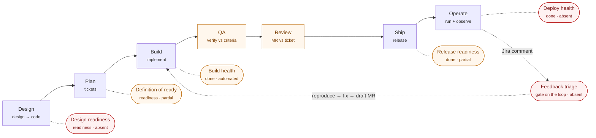
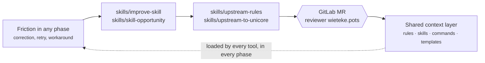

# Pipeline Map

Where every rule, skill, and command in this repo fires in the delivery process.

This repo already has two inventories **by type** — `docs/workflow-canonical-sources.md`
(which surface is canonical per workflow) and `FEATURES.md` (what exists). This
document is the inventory **by process**: for each phase of the delivery pipeline,
which surfaces run, which quality gate closes the phase, and whether that gate is
actually automated or only written down.

Read it to answer three questions:

1. I am at point X in the process — what should I invoke?
2. Which gates does a change pass before it reaches production?
3. Where does the pipeline still rely entirely on a human remembering?

It is written against the seven-phase AI-augmented pipeline spec, and
[Coverage against the pipeline spec](#coverage-against-the-pipeline-spec) states per
proposed automation whether this repo has it, partly has it, or does not.

## The pipeline

QA and Review are drawn as phases because they are also gates in their own right —
everything reaching Ship has passed both, and an AI-authored change passes the same
two, never a lighter parallel path. The other gates hang off the phase they guard:
a **readiness** gate guards a phase's entrance, a **done** gate guards its exit.

## Quality gates

Gates come in two kinds. A **readiness** gate guards the *entrance* to a phase — do
not start work on bad input. A **done** gate guards the *exit* — do not let bad
output advance. Two principles follow from that:

- **Cheapest first.** Build health runs in seconds, QA in minutes, Review costs human
  attention. A change that does not compile should never reach a reviewer, and each
  gate only runs on input that cleared the cheaper one before it.
- **Readiness gates block entry, they do not warn.** The cheapest quality win in the
  whole pipeline is refusing to start work on a vague ticket or an unresolved design.
  Catching that at the entrance costs a comment; catching it at Review costs a rebuild.

| Gate | Kind | Guards | Enforced by | Status |
| --- | --- | --- | --- | --- |
| Design readiness | readiness | entry to Plan — design resolved, tokens and states settled, a11y decided | nothing | ❌ absent |
| Definition of ready | readiness | entry to Build — testable acceptance criteria, clear definition of done, no ambiguity | `skills/refinement` + `rules/backlog.md` | ⚠️ partial — encoded, never blocking |
| Build health | done | exit from Build — compiles, types, lint, unit tests, no committed secrets | `skills/run-checks`, plus `skills/migration-check` when the diff touches migrations | ✅ automated, ⚠️ not derived from the CI job list |
| QA | done | the build against the ticket's acceptance criteria, per criterion | `skills/run-checks`, `skills/code-review`, `skills/architecture-review`, `skills/wcag-audit`, `skills/sustainable-review` — but nothing maps a result back to a specific criterion | ⚠️ partial — verification without traceability |
| Review | done | the MR against the ticket | `skills/code-review`, `skills/receiving-code-review` | ⚠️ partial — no ticket-drift or doc-freshness check |
| Release readiness | done | safe to ship — dependency and licence scanning, API-contract/breaking-change detection, docs updated | `skills/watch-mrs` (approval, pipeline, conflicts via `detailed_merge_status`), `skills/npm-maintenance` (dependencies, out of band) | ⚠️ partial — merge-readiness only, armed by hand |
| Deploy health | done | the release is healthy in production — smoke tests, canary, rollback ready | nothing | ❌ absent |
| Feedback triage | gate on the loop | is this comment actionable at all, before anything is reproduced or fixed | nothing | ❌ absent |
| Workflow-asset review | done | any change to **this** repo | feature branch → GitLab MR → reviewer `wieteke.pots` (`shared/workflow-assets.md`) | ✅ policy, human-enforced |

## The improve loop

The seven-phase picture describes how work flows through a *product* repo. It does
not show how work re-enters *this* repo — which is the whole reason ai-workflows
exists. That is the eighth lane:

Every change to this repo passes that gate — a developer editing a rule by hand and
an agent running an upstream skill are treated identically. No direct pushes to
`main`, and the GitHub mirror is not a substitute.

## Phase by phase

### Design — design → code

Turning a design or a requirement into something implementable.

| Surface | Type | Role |
| --- | --- | --- |
| `skills/component-spec` | skill | Production-ready component spec: API, a11y requirements, keyboard + screen-reader behaviour, testing guidance, open questions |
| `rules/tailwind.md` | rule | Design tokens via `@theme`; how a design system maps onto utilities |
| `rules/accessibility.md` | rule | Semantics, contrast, keyboard behaviour — decided here, not patched in QA |
| `packages/accessibility` | package | Optional a11y preset bundle for a target project |
| Figma MCP | connector | `get_design_context`, `get_variable_defs`, `get_screenshot` — provided by the Figma connector, not by `mcp/servers.json` |

**Gate — Design readiness: absent.** Nothing checks that design tokens, states, and
a11y behaviour are settled before a ticket is written. See [Gaps](#gaps).

### Plan — tickets

Turning intent into work items with acceptance criteria.

| Surface | Type | Role |
| --- | --- | --- |
| `skills/refinement` | skill | Prep and record refinement: grouping, story points, conflicts, per-ticket questions — tracker read-only |
| `skills/sprint-planning` | skill | Sprint scope, spillover carry-in, dependency mapping, realism against velocity |
| `skills/backlog` | skill | Draft or update a local backlog item in `docs/backlog/` |
| `skills/jira-ticket` | skill | Create a Jira bug/story/task from a type-specific template — the one sanctioned tracker **write** |
| `skills/sprint-board` | skill | Opens the item on the per-sprint board and tracks it through every later status |
| `commands/refinement.md`, `commands/sprint-planning.md`, `commands/backlog.md` | commands | Fallback runbooks for tools that cannot use skills |
| `rules/backlog.md` | rule | User story, spec, and backlog-item structure |
| `docs/backlog/` | context | Local BLIs — the definition of done that `skills/work-backlog` consumes |

**Gate — Definition of ready: partial.** `skills/refinement` and `rules/backlog.md`
define readiness; nothing prevents an unready item from being picked up.

### Build — implement

| Surface | Type | Role |
| --- | --- | --- |
| `skills/work-backlog` | skill | Autonomous delivery of one BLI, WIP limit 1 — spans Plan → Review and calls the phases below |
| `skills/test-driven-development` | skill | Strict RED-GREEN-REFACTOR for a feature or bugfix |
| `skills/scaffold-component` | skill | New component with the project's file structure and conventions |
| `skills/commit-message` | skill | Conventional commit message from the diff |
| `commands/work-backlog.md`, `commands/scaffold-component.md`, `commands/commit-message.md`, `commands/safe-kill-port.md` | commands | Fallback runbooks; `safe-kill-port` is local-dev hygiene (`EADDRINUSE`) |
| `rules/project.md` | rule | Structure, naming, component architecture, function style |
| `rules/type-safety.md` | rule | Trust boundaries, strict TS posture, lint guardrails |
| `rules/clean-architecture.md` | rule | Layer boundaries and dependency direction |
| `rules/content-blocks.md`, `rules/payload.md` | rules | CMS-backed block architecture; Payload schemas, generated types, hooks |
| `rules/testing.md` | rule | Testing strategy and query priority while writing code |
| `rules/sustainability.md` | rule | Runtime, bundle, and asset cost as a build-time concern |
| `rules/stacks/nextjs-payload.md`, `rules/stacks/react-native-expo.md` | rules | Stack-specific conventions layered on the baseline |

**Gate — Build health: automated** via `skills/run-checks`.

### QA — verify vs criteria

Verifying the change against its acceptance criteria and the project's standards,
before another human is asked to look at it.

| Surface | Type | Role |
| --- | --- | --- |
| `skills/run-checks` | skill | Lint, type-check, stylelint, test, build in sequence; stops on failure for a decision |
| `skills/code-review` | skill | Severity-ordered self-review of the branch diff with explicit type-safety audit |
| `skills/architecture-review` | skill | Clean-architecture violations against the project's *actual* folder mapping |
| `skills/migration-check` | skill | Static check of a generated Payload/Postgres migration for snapshot drift — read-only, never runs `migrate` |
| `skills/wcag-audit` | skill | Static WCAG review against `rules/accessibility.md` (the automated production scan sits in Operate) |
| `skills/sustainable-review` | skill | Runtime, bundle, asset, dependency and CI cost of the change |
| `commands/run-checks.md`, `commands/review-code.md`, `commands/sustainable-review.md` | commands | Fallback runbooks |
| `rules/sonarqube.md` | rule | Quality-gate expectations for static analysis |

**Gate — Build health: automated.** Note the sustainability constraint: the full
sweep runs **once**, immediately before pushing — QA scopes checks narrowly while
building instead of re-running everything.

### Review — MR vs ticket

| Surface | Type | Role |
| --- | --- | --- |
| `skills/create-pr` | skill | Rebase onto base, push, open PR/MR with a description generated from the diff; pre-flight delegates to `skills/migration-check` |
| `commands/create-pr.md` | command | Fallback runbook |
| `skills/code-review` | skill | Review a branch, MR, or PR by URL; can post inline MR comments after a go-ahead |
| `skills/receiving-code-review` | skill | Evaluate incoming feedback with rigour — verify, push back where wrong, then apply |
| `skills/address-review-comments` | skill | Apply approved feedback, run checks, push, rebase, clean up |
| `skills/watch-mrs` | skill | Background loop over new comments and merge-readiness; opt-in auto-merge |
| `skills/sprint-board` | skill | Moves the item to *in review* / *rework* |

**Gate — Release readiness: automated but armed by hand.** `skills/watch-mrs` can
watch a MR the moment it exists, but nothing arms it — which is why a red pipeline
can sit unnoticed. See [Gaps](#gaps).

### Ship — release

| Surface | Type | Role |
| --- | --- | --- |
| `skills/watch-mrs` | skill | Merges once the MR is mergeable, when auto-merge was explicitly enabled for that invocation |
| `skills/close-sprint` | skill | Sprint changelog, gaps/spillover, delivered BLIs moved into a sprint folder |
| `skills/sprint-demo` | skill | Presenter runsheet plus a Marp deck for sprint review |
| `commands/close-sprint.md`, `commands/sprint-demo.md` | commands | Fallback runbooks |

**Gate — Deploy health: absent.** Nothing verifies a deploy, drafts release notes,
or hands the PO a way to test what shipped. See [Gaps](#gaps).

### Operate — run + observe

| Surface | Type | Role |
| --- | --- | --- |
| `skills/npm-maintenance` | skill | Dependency updates, `npm audit` remediation, researched major migrations |
| `skills/wcag-audit` | skill | axe-core/Playwright scan of the live site, combined with the static findings |
| `skills/sustainable-review` | skill | Production runtime, caching, asset and CI-cost audit |
| `skills/jira-ticket`, `skills/backlog` | skills | The landing point of feedback triage: an observation becomes a ticket or a BLI |

A broader periodic project-maintenance sweep (deps, runtime EOL, credential and
API-key currency, CI hygiene, doc drift) is in flight on another branch and lands
in this phase.

**Feedback triage** is the dotted arrow back into Build, and it is a gate before it is
an automation: classify whether the comment is actionable at all, reproduce it as a
failing test before fixing anything, stop and ask on the ticket when it cannot be
reproduced, and open the fix as a **draft** MR that re-enters the pipeline at QA and
Review like any other change. No surface owns any of that today — see
`docs/backlog/feat-jira-feedback-loop.md`. The failure mode being designed against is
not a bad fix surviving review; it is an agent confidently "fixing" a misclassified
comment, or a fix that passes its own narrow reproduction test while breaking what the
test never covered. Both are caught by the full QA pass and the human merge gate,
which is exactly why an AI-authored change gets neither skipped.

### Improve — maintaining the pipeline

| Surface | Type | Role |
| --- | --- | --- |
| `skills/improve-skill` | skill | Post-run retrospective: fold friction back into the skill's canonical source, or author a new skill |
| `skills/skill-opportunity` | skill | Decide from working sessions whether a new or updated skill is warranted |
| `skills/upstream-rules` | skill | Propose a rule/skill change back to this repo as a GitLab MR |
| `skills/upstream-to-unicore` | skill | Port a reusable change into `unicore-template` |
| `skills/init-project` | skill | Generate `CONVENTIONS.md`, thin tool adapters, and sync shared assets into a project |
| `commands/init-project.md`, `commands/new-device-setup.md` | commands | Fallback runbook; new-machine bootstrap |
| `scripts/sync.sh`, `scripts/generate-adapters.sh` | scripts | Distribute canonical sources to projects and regenerate derived adapters |
| `scripts/validate-ai-instructions.sh`, `scripts/validate-skills.mjs`, `scripts/install-hooks.sh`, `scripts/smoke-test-project-sync.sh` | scripts | Drift detection: CI and the pre-commit hook run the same validators |
| `docs/workflow-canonical-sources.md` | doc | Which surface is canonical per workflow |
| `docs/skills-first-migration-plan.md` | doc | Why skills are canonical and commands are the fallback |
| `shared/workflow-assets.md` | shared | What counts as a shared workflow asset, and how it lands |

## Shared context layer

This is not one physical store that everything is copied into. It is a **logical
access layer**: agents query it, and each piece is owned by whichever system is its
master. The decision per data type is what keeps it from rotting:

| Data | Master | Why |
| --- | --- | --- |
| Tickets, acceptance criteria, comments | **Jira, live** | Authored elsewhere, changes on its own schedule. Mirroring it into the repo creates two masters — prose conflicts, stale copies, sync-commit noise — and quietly demotes Jira from single source of truth. Fetch it; never mirror-and-sync. |
| Design tokens | **repo** (Figma upstream, one-way) | The committed token file is a code artefact; Figma generates into it, never the reverse. |
| Conventions | **repo** | Already code: lint config, `rules/`, `CONVENTIONS.md`. |
| Architectural decisions | **repo** | ADRs are committed markdown next to the code they explain. |
| The requirements a branch was built against | **read-only snapshot, pinned per branch** | See below. |

**The snapshot pattern.** A gate that checks work against *live* Jira is not
reproducible: it passes or fails depending on when it runs, because the ticket can
change after the MR is opened. So when work starts on a ticket, drop a read-only
snapshot of the requirements and acceptance criteria *as they were at that moment*
into the branch, and never write back. That gives a stable contract for the QA and
Review gates to test against, an audit trail of asked-versus-built, and — when the
ticket moves materially mid-flight — a re-snapshot, which is itself the signal that
requirements changed after work began. The discipline is that the snapshot is
regenerated, never hand-edited: it is a cache of the contract, not a second copy of
the ticket.

**This repo has no snapshot mechanism today.** Every tracker-reading skill reads live,
which is why `docs/backlog/feat-ticket-drift-check.md` is specified around the
snapshot rather than around a live diff.

The repo-owned half, in real paths:

| Asset | What it carries |
| --- | --- |
| `CONVENTIONS.md` (per project) | The single source of project truth; every tool adapter points at it |
| `rules/rules.md` | Index — which rule file loads when |
| `rules/communication.md` | Tone and response style, tool-independent |
| `shared/core-rules.md`, `shared/command-mappings.md`, `shared/safety.md`, `shared/graphify.md` | Fragments injected into generated adapters, so every tool sees the same baseline |
| `templates/project-CLAUDE.md`, `templates/project-AGENTS.md`, `templates/project-copilot-instructions.md`, `templates/project-cursor-conventions.mdc`, `templates/project-cursor-graphify.mdc`, `templates/project-ai-workflows.md`, `templates/project-claude-settings.json` | Thin per-tool adapters generated into a project |
| `templates/pull_request_template.md` | Last-resort MR body skeleton for `skills/create-pr` |
| `packages/selection.md`, `packages/greenberry-base`, `packages/frontend`, `packages/nextjs`, `packages/payload`, `packages/testing` | Composable convention bundles per target project |
| `mcp/servers.json` | Canonical MCP server definitions (github, filesystem, context7) |
| `docs/backlog/` | Local backlog items — the contract `skills/work-backlog` delivers against |
| `docs/board/sprint-<N>-board.md` | Per-sprint work board (untracked, project-local) |
| `graphify-out/` | Generated knowledge graph over the repo, queried before re-reading files |

Live context — the Jira box in the diagram — is read through MCP at run time. Every
tracker-reading skill treats it as **read-only**; only `skills/jira-ticket` writes,
and only after explicit confirmation. `docs/backlog/feat-mr-merged.md` adds the second
sanctioned write: the "how to test this" comment for the product owner.

## Coverage against the pipeline spec

The seven-phase spec proposes a set of automations per phase. This is where this repo
actually stands against it — the alignment view, not a wish list.

| Phase | Spec proposes | Here | Surface |
| --- | --- | --- | --- |
| Design | a11y audit on Figma frames | ❌ | `skills/wcag-audit` audits code and the live site, not frames |
| Design | component reuse check (new component, or does it exist?) | ❌ | — |
| Design | token drift: codebase vs Figma source | ❌ | — |
| Design | responsive/interaction spec extraction | ⚠️ | `skills/component-spec`, from requirements rather than from frames |
| Plan | ticket quality gate (blocking) | ⚠️ | `skills/refinement` advises, never blocks |
| Plan | epic decomposition with dependencies | ⚠️ | `skills/sprint-planning` maps dependencies; no decomposition |
| Plan | duplicate/overlap detection, auto-linking to past work | ❌ | — |
| Plan | acceptance criteria → test cases | ❌ | filed: `docs/backlog/feat-requirements-traceability.md` |
| Build | scaffold from ticket (files, components, failing test) | ⚠️ | `skills/work-backlog` + `skills/scaffold-component`, no test skeleton from criteria |
| Build | convention enforcement while writing | ✅ | `rules/` loaded per phase, `skills/code-review` as backstop |
| Build | codemod / migration assistant | ⚠️ | `skills/npm-maintenance` for dependencies, `skills/migration-check` for DB migrations; no general codemod |
| QA | requirements traceability: criterion → test → result, per criterion | ❌ | filed: `docs/backlog/feat-requirements-traceability.md` |
| QA | flag untestable criteria back to the readiness gate | ❌ | filed with the above |
| QA | visual regression against the Figma frame | ❌ | — |
| QA | a11y verification | ✅ | `skills/wcag-audit`, `rules/accessibility.md` |
| Review | auto-generated MR description from diff + ticket | ✅ | `skills/create-pr` |
| Review | semantic first-pass review beyond linting | ✅ | `skills/code-review` |
| Review | breaking-change / API-contract detection | ❌ | — |
| Ship | CI failure triage in plain language | ❌ | filed: `docs/backlog/feat-pipeline-triage.md` |
| Ship | release notes / changelog + semver suggestion | ⚠️ | `skills/close-sprint` at sprint level, not per release |
| Operate | incident triage: error spike → likely PRs | ❌ | — |
| Operate | log/error summarisation, on-call assistant | ❌ | — |
| Operate | docs-in-sync: code changed, which docs/ADRs are stale | ⚠️ | filed per-MR: `docs/backlog/feat-doc-and-comment-freshness.md` |
| Loop | Jira comment → triage → reproduce → fix → draft MR | ❌ | filed: `docs/backlog/feat-jira-feedback-loop.md` |
| Context | read-only snapshot pinned per branch | ❌ | filed: `docs/backlog/feat-ticket-drift-check.md` |

Read that column honestly: this repo is strong where the spec says the work is easy
(generation — scaffolding, descriptions, tickets) and thin exactly where the spec says
quality actually comes from (the gates). Design and Operate are close to empty.

## Gaps

Ordered by how often they bite. Each is filed as a backlog item.

| # | Gap | What it costs today | Filed as |
| --- | --- | --- | --- |
| 1 | Nothing arms a monitor after the MR is opened; no review or ticket-drift pre-flight | A red pipeline sits unnoticed; a reviewer sees what a self-review would have caught | `docs/backlog/chore-create-pr-preflight-and-monitor.md` |
| 2 | No requirements snapshot pinned per branch, so no check that the ticket still says what it said when work started | AC changed or a comment moved the scope, and the MR silently misses it — and a gate that reads live Jira is not reproducible | `docs/backlog/feat-ticket-drift-check.md` |
| 3 | No surface triages a failing pipeline | The same CI failure recurs because nobody reads the job trace | `docs/backlog/feat-pipeline-triage.md` |
| 4 | `skills/watch-mrs` reports merge status, not pipeline detail, and hands off to nothing | You learn *that* it failed, not *which job* — and merge is a dead end | `docs/backlog/chore-watch-mrs-pipeline-and-merge-handoff.md` |
| 5 | The local check sweep is not derived from the CI job list | Green locally, red in CI | `docs/backlog/chore-run-checks-ci-parity.md` |
| 6 | Nothing happens after merge | The PO never gets a "how to test this"; the board and ticket drift | `docs/backlog/feat-mr-merged.md` |
| 7 | No policy or review dimension for stale comments and docs | Outdated comments mislead the next reader — human or agent | `docs/backlog/feat-doc-and-comment-freshness.md` |
| 8 | Project kickoff starts at stack detection, not at intent | Brief, spec and architecture decisions live in someone's head or in Slack | `docs/backlog/feat-start-project.md` |
| 9 | "Run `improve-skill` after a run that needed intervention" is prose, not a hook | The retrospective happens when someone remembers | `docs/backlog/chore-improve-skill-stop-hook.md` |
| 10 | QA verifies, but no result maps back to a specific acceptance criterion | "Done" stays an assertion instead of something provable per criterion | `docs/backlog/feat-requirements-traceability.md` |
| 11 | A Jira comment reporting a problem starts a manual round trip | The loop back into Build is human-driven, so feedback queues behind attention | `docs/backlog/feat-jira-feedback-loop.md` |

Everything else the spec proposes is in the coverage table above rather than filed —
recording it beats twenty draft items nobody picks up.

**Build order.** The spec's own sequencing argues for the context layer and the ticket
quality gate first, because every downstream automation reasons from ticket quality,
then the design token and component-reuse checks, then the review automations —
scaffolding last, since generation is the low-leverage half. Mapped onto this repo,
that puts items 2 and 10 (snapshot + traceability) ahead of the rest, and Design
coverage ahead of anything else that merely makes existing work faster.

## Keeping this map accurate

`scripts/validate-skills.mjs` checks this file on every commit (via
`scripts/install-hooks.sh`) and in CI (via `scripts/validate-ai-instructions.sh`):

- a repo path named here that does not exist → **error**
- a path that exists but is untracked → **warning** (a work-in-progress surface)
- a tracked skill, command, or rule that appears nowhere in this file → **warning**

So adding a skill without placing it in the process is a visible warning, not a
silent omission. When a phase or gate itself changes, update the Mermaid diagram
and the gate table by hand — that structure is deliberately not generated.
