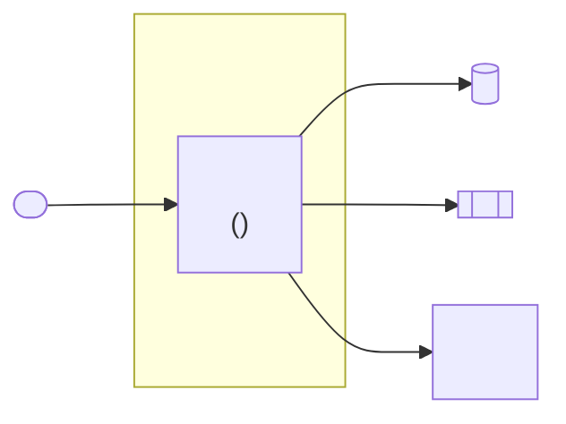
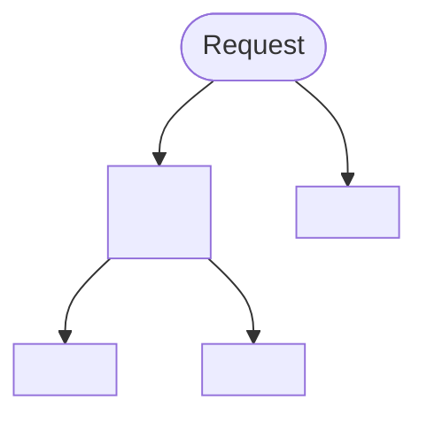
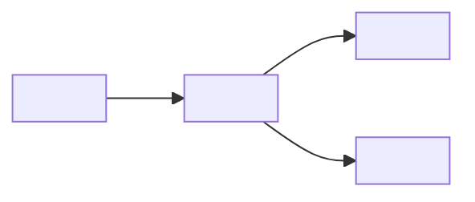
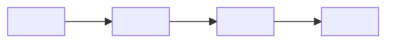
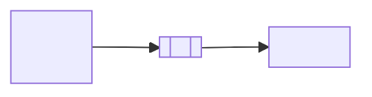

<!--
Template for docs/architecture.md — written by skills/start-project.

This document holds INTENT and RATIONALE: the system-level map, the layer
mapping the project means to have, the runtime paths, the trust boundaries, the
deployment topology, and the decisions that produced them. CONVENTIONS.md holds
DETECTED FACTS (stack versions, scripts, the folders that exist today) and points
here for the why. Pattern-level rules that must be followed while coding belong
in rules/.

Boundary, so the two documents cannot drift:
- A folder path appears here with the layer it belongs to and the reason.
- CONVENTIONS.md lists what the tree looks like now and links here.
- When the intended mapping changes, it changes here first, as a decision.

Rules for filling it in:
- Drop any section this project does not have. An empty section with
  placeholders is worse than no section.
- Diagrams are mermaid, inline in this file: they render on GitLab and GitHub
  and stay reviewable in a diff. At minimum a system-context diagram; add a
  request-path diagram as soon as more than one surface shares the runtime.
- A decision belongs in the log only if it was actually made. A design someone
  is still weighing goes to "Open Questions" with the options, not to the log.
- Every decision entry gets a date and a status; superseded entries stay, with
  a pointer to what replaced them.
- "Known Architectural Debt" is for deviations that exist in the code today and
  are tracked elsewhere. "Open Questions" is for design nobody has decided yet.
  Never park a known deviation as an open question — it has an answer, it just
  is not implemented.
- Write in the language the project's other docs use; default to English.
- Remove this comment block from the generated file.
-->

# Architecture: <project name>

<One paragraph at system level: which processes exist, which external services
they talk to, and how a request travels through the app.>

This document is the **map**, not the rulebook. It links to the documents that
own each detail instead of repeating them — when a rule and this file disagree,
the rule wins.

| Question | Document |
| --- | --- |
| What are the folders, stack, scripts? | `CONVENTIONS.md` |
| Which layer may import which? | `rules/clean-architecture.md` |
| How does one route render? | `rules/architecture.md` <or the project's own pattern rule> |
| What does the product do, for whom? | `docs/project-spec.md`, `docs/project-brief.md` |
| How does feature X work in detail? | `docs/specs/` |
| How do I run it, which env vars exist? | `README.md` |
| What does the code actually look like today? | `graphify-out/GRAPH_REPORT.md` (generated) |

## Status

<Draft | Reviewed | Approved> — <date>

## System Context

<One sentence on the runtime shape: how many processes serve which surfaces, and
what is deliberately not a separate deployment.>

<Where third-party coupling is allowed to live (the folder), and what that code
is not allowed to know about.>

## Deployment Topology

| Concern | Choice | Notes |
| --- | --- | --- |
| Hosting | <provider / runtime> | <region, scaling model> |
| Database | <engine + hosting> | <backups, migrations> |
| Media / assets | <storage> | <CDN, transforms> |
| Email | <provider> | <transactional only?> |
| Preview / draft | <mechanism> | <who may reach it> |
| CI/CD | <pipeline> | <what gates a deploy> |
| Observability | <logs, errors, analytics> | <retention, who watches it> |

### Runtime constraints

The topology facts that code has to honour, stated as constraints:

- <e.g. multiple instances behind a load balancer: nothing may assume in-process
  state is shared>
- <how env config is loaded and validated, and which source wins over which>
- <scheduled work: what guarantees it fires once across the fleet>
- <environment protection: what keeps non-production surfaces private>

## Request Paths

Notes — the exceptions a reader cannot guess from the diagram:

- <what the matcher deliberately excludes, and why>
- <which surface owns which path prefix, and what keeps two APIs from colliding>
- <how preview / draft mode enters, and what authenticates it>

## Read Path And Caching

<The contract every route follows, named once here and owned by a rule.>

- <what is cached cross-request, with the mechanism>
- <what must never be cached cross-request: user-bound, request-bound, preview>
- <where cache keys/tags come from — the module, never inline literals>

Invalidation is the mirror image, driven by the write side:

<Any cascade a reader would be surprised by: one save invalidating a tree, or
one invalid child blocking a parent write.>

## Code Layers

Dependencies flow inward only: Presentation → Application → Infrastructure →
Domain. See `rules/clean-architecture.md` for the principles this maps onto.

| Path | Layer | Holds | Why here |
| --- | --- | --- | --- |
| `<src/…>` | <Domain / Infrastructure / Application / Presentation> | <what lives there> | <the reason this path carries this layer> |

- **Enforced by**: <lint rule / import boundary / nothing yet> at
  <error | warn | unenforced>. <What that severity means for existing code:
  warn-level means non-conforming code still exists and is tracked below.>
- **Supporting distinctions**: <the folder pairs people confuse, and the one
  sentence that separates them — e.g. project-agnostic vs project-aware vs
  deliberately third-party-coupled>.

<Any deliberate deviation from the canonical mapping, and what makes it
intentional rather than drift.>

## Data Model

| Entity | Owns | Relationships | Notes |
| --- | --- | --- | --- |
| `<Entity>` | <the data it is the master of> | <has many / belongs to> | <soft delete, versioning, localization> |

<Where the schema actually lives (CMS collections, migrations, ORM models), and
what the rule is for changing it. Group the entities by role when there are many
— routable pages, domain records, operational tables — so a reader can tell
which ones carry product meaning.>

## Trust Boundaries

Every edge where untrusted data enters, and what validates it. See
`rules/type-safety.md` for the posture this implements.

| Boundary | Data | Validated by | Failure behaviour |
| --- | --- | --- | --- |
| <env vars / CMS payload / webhook / form submit / third-party API / uploaded file> | <what arrives> | <schema or guard, with its path> | <reject, fall back, log> |

<What is deliberately trusted, and why that is safe. An edge with no validation
today gets a row too — that row is the honest one.>

## Auth And Authorization

- <where authentication lives, and which surfaces share the session>
- <the roles, and where they are implemented — the detail belongs in a spec,
  linked, not restated here>
- <what enforces the surfaces: route grouping, guards, signed links>

## Background Jobs

<Drop this section when there is no scheduled or queued work.>

- <what prevents duplicate runs across instances>
- <how failure is noticed, separately for "ran but failed" and "never ran">

## Media And Assets

<Drop when uploads are not part of the product.>

<Upload path, delivery path, and the local-development fallback.>

## Cross-Cutting Concerns

Each one names the mechanism and the rule that owns it, and nothing more:

- **Security headers**: <where the list lives, what applies it>
- **Consent / analytics**: <what gates third-party scripts>
- **Localization**: <content locales vs UI copy, and where each lives>
- **Accessibility**: <target, mechanism, rule>
- **Testing**: <runners and what each covers, strategy doc>
- **Error handling**: <boundary behaviour, what the user sees>

## Decision Log

Newest first. One entry per decision that constrains later work.

### ADR-001 — <decision title>

- **Date**: <date>
- **Status**: <proposed | accepted | superseded by ADR-00N>
- **Context**: <the forces in play: constraint, deadline, existing code, team skill>
- **Decision**: <what was chosen, stated so a reader can act on it>
- **Consequences**: <what this makes easy, what it makes expensive, what it rules out>
- **Alternatives considered**: <option — why not>

## Known Architectural Debt

Tracked, not resolved. Each entry names the deviation, where it lives, and what
tracks it — a backlog item, a todo, or an epic. An entry with no tracker is not
debt, it is a surprise waiting to happen.

- <deviation — where it lives — `<link to the item that tracks it>`>
- <a document or rule that points at something that no longer exists, when you
  found one while writing this>

When you extend code that does not follow the architecture above, conform to the
rule rather than the neighbouring code, and record the deviation you found in
<`docs/todo/`> instead of widening the change.

## Open Questions

- <architectural question still open, the options on the table, and what would
  settle it>
